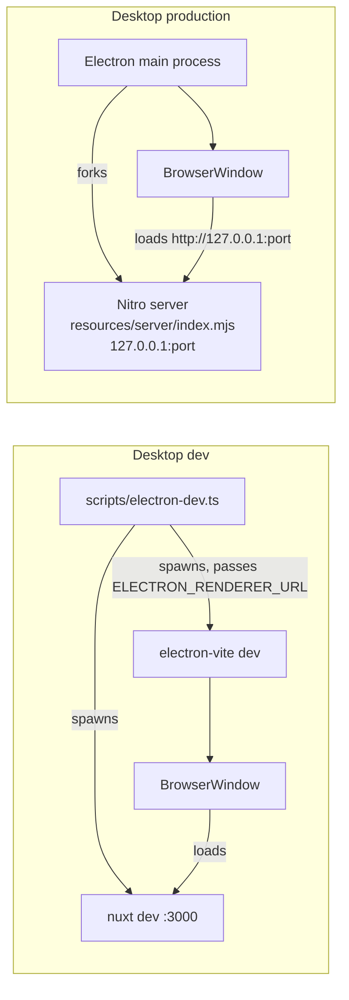

# electronuxt

A [Nuxt 4](https://nuxt.com) application that also ships as a desktop app. Instead of downgrading to a static SPA for Electron, the desktop build runs the **full Nuxt SSR/Nitro server locally** inside the app — so `server/api` routes, server middleware, and server-side rendering all keep working exactly as they do on the web.

Inspired by [lincenying/vite-nuxt-electron](https://github.com/lincenying/vite-nuxt-electron) and [caoxiemeihao/nuxt-electron](https://github.com/caoxiemeihao/nuxt-electron).

## Stack

| Layer      | Technology                                                        |
| ---------- | ----------------------------------------------------------------- |
| Frontend   | Nuxt 4, Vue 3, shadcn-vue (`reka-lyra`), Tailwind CSS v4          |
| Validation | Valibot (env parsing, forms, IPC boundaries)                      |
| Desktop    | Electron, electron-vite, electron-builder, electron-updater       |
| Tooling    | pnpm, oxlint, oxfmt, husky + lint-staged, vue-tsc, GitHub Actions |

## Getting started

```sh
pnpm install        # installs deps, runs `nuxt prepare`
pnpm dev            # web: Nuxt dev server
pnpm dev:electron   # desktop: Nuxt dev server + Electron window with HMR
```

Node version is pinned in `.nvmrc`.

## Commands

| Command               | What it does                                                               |
| --------------------- | -------------------------------------------------------------------------- |
| `pnpm dev`            | Start the Nuxt dev server (web only)                                       |
| `pnpm dev:electron`   | Run the desktop app in dev with full HMR (see [Dev mode](#dev-mode))       |
| `pnpm build`          | Production build of the Nuxt app (`.output/`)                              |
| `pnpm build:electron` | Build the Electron main/preload bundles (`.electron/dist/`)                |
| `pnpm package`        | `build` + `build:electron` + package the desktop app locally               |
| `pnpm generate`       | Static site generation (web only)                                          |
| `pnpm preview`        | Preview a production web build                                             |
| `pnpm typecheck`      | `nuxt typecheck` (vue-tsc) + `tsc -p electron/tsconfig.json`               |
| `pnpm lint`           | oxlint                                                                     |
| `pnpm fmt`            | oxfmt, then verify formatting                                              |
| `pnpm release <type>` | Bump version, changelog, commit, tag, push — triggers the release workflow |

## How it works

The same Nuxt app runs in three modes:

1. **Web** — plain Nuxt. Electron is not involved at all.
2. **Desktop dev** — Electron opens a window pointed at the Nuxt dev server, so you keep HMR, devtools, and the full dev experience.
3. **Desktop production** — Electron forks the built Nitro server (`.output/server/index.mjs`) as a child process on `127.0.0.1` and loads the app from it. SSR and `server/api` behave exactly like a deployed Nuxt app, just running locally.



### Dev mode

`pnpm dev:electron` runs [`scripts/electron-dev.ts`](scripts/electron-dev.ts), which:

1. Spawns `nuxt dev --port 3000` and watches its stdout (ANSI-stripped, buffered across chunks) for the `Local: http://…` URL.
2. Polls that URL until it responds.
3. Spawns `electron-vite dev` with `ELECTRON_RENDERER_URL` set to the dev server URL. The main process sees that variable and loads the dev server directly — full HMR, no Nitro fork.
4. On exit/Ctrl-C it kills both process trees (process groups on Unix, `taskkill /t` on Windows).

### Production mode

In the packaged app there is no dev server, so the main process:

1. Allocates a port on `127.0.0.1` (see [Stable origin](#stable-origin-port-persistence)).
2. Forks `resources/server/index.mjs` (the built Nitro server, shipped as an Electron resource) with `HOST`/`PORT` and a freshly generated API token in its environment. Electron runs the fork with `ELECTRON_RUN_AS_NODE`, so it's a plain Node process.
3. Polls the server until it answers with a 2xx (probe failures within 10s kill the child and abort startup — no orphaned processes).
4. Creates the `BrowserWindow` and loads `http://127.0.0.1:<port>`.
5. Registers a `before-quit` hook that terminates the Nitro child.

The server is started **once** and cached; reopening the window from the macOS dock reuses it.

### Stable origin (port persistence)

A web origin includes the port. If the port changed on every launch, the renderer would get a brand-new origin each time — silently wiping `localStorage`, `IndexedDB`, and cookies. To avoid that, the first allocated port is persisted to `userData/nitro-port` and reused on later launches whenever it is still free; only if it's taken does the app fall back to a new free port (and persist that instead).

### Local API security

Anything listening on `127.0.0.1` is reachable by **every process on the machine**, not just the app. To keep other software from calling the app's API:

- The main process generates a random 32-byte token per launch and hands it to the Nitro child via `NUXT_ELECTRON_API_TOKEN`.
- A session-level `webRequest.onBeforeSendHeaders` hook stamps the token onto every renderer request to the server origin as `x-electron-api-token` — page loads, asset requests, and client-side `$fetch`/`useFetch` all carry it automatically.
- [`server/middleware/electron-api-token.ts`](server/middleware/electron-api-token.ts) rejects any request without the correct token (401). When the token env is empty — plain `nuxt dev`, `nuxt preview`, or Electron dev against the dev server — the check is disabled entirely.

SSR-internal fetches also pass the check: Nuxt's `useRequestFetch` forwards the incoming request's headers, and the document request carries the token.

Additional hardening in the main process:

- `contextIsolation: true`, `sandbox: true`, `nodeIntegration: false` on every window.
- A deny-all `setPermissionRequestHandler` (camera/mic/geolocation/notification requests are refused; Electron's default is to **grant** them).
- `window.open` and cross-origin navigations are denied and routed to the OS browser instead — restricted to `http:`/`https:` URLs only.
- A single-instance lock: launching the app twice focuses the existing window instead of starting a second server.

## Electron file guide

Everything Electron-specific lives in `electron/`, built by [electron-vite](https://electron-vite.org) via [`electron.vite.config.ts`](electron.vite.config.ts) into `.electron/dist/`.

```
electron/
├── main/                 # Main process (Node context, controls the app)
│   ├── index.ts          # Entry point: app lifecycle, single-instance lock,
│   │                     #   permission handler, token header hook, starts the
│   │                     #   server once and creates windows
│   ├── window.ts         # BrowserWindow factory: security webPreferences,
│   │                     #   external-link policy (http/https allowlist)
│   ├── server.ts         # Production only: port persistence, token generation,
│   │                     #   forks the Nitro server, readiness probe, cleanup
│   ├── updater.ts        # electron-updater wired to GitHub Releases; broadcasts
│   │                     #   status to all windows over IPC
│   ├── logger.ts         # electron-log setup (file + console transports)
│   └── ipc/
│       └── app.ts        # ipcMain.handle handlers; every payload is
│                         #   Valibot-validated at the boundary
├── preload/
│   └── index.ts          # contextBridge: exposes window.api / window.electron
│                         #   to the renderer; its `Api` type is the source of
│                         #   truth for the Nuxt side
├── shared/
│   ├── ipc-channels.ts   # IPC channel name constants (main + preload)
│   └── schemas.ts        # Valibot schemas + types shared across the IPC boundary
└── tsconfig.json         # Separate Node-targeted TS project (not part of the
                          #   Nuxt/vue-tsc project); covered by `pnpm typecheck`
```

Related files outside `electron/`:

| File                                      | Role                                                                        |
| ----------------------------------------- | --------------------------------------------------------------------------- |
| `electron.vite.config.ts`                 | Builds `main` (ESM) and `preload` (CJS) — see [Build quirks](#build-quirks) |
| `electron-builder.yaml`                   | Packaging config: what ships in the app and how                             |
| `scripts/electron-dev.ts`                 | Dev orchestrator (Nuxt dev server + Electron)                               |
| `server/middleware/electron-api-token.ts` | Nitro-side half of the local API token check                                |
| `app/types/electron-api.d.ts`             | Ambient types for `window.api` / `window.electron` in the Nuxt app          |
| `scripts/release.ts`                      | Version bump + changelog + tag push (feeds the release workflow)            |

### IPC pattern

The renderer never touches Electron APIs directly. The flow for adding a new capability:

1. Add a channel constant in `electron/shared/ipc-channels.ts` and, if it takes a payload, a Valibot schema in `electron/shared/schemas.ts`.
2. Register an `ipcMain.handle` in `electron/main/ipc/` — parse the payload with the schema before doing anything (`v.parse` throws on bad input).
3. Wrap the `ipcRenderer.invoke` in a typed function in `electron/preload/index.ts` and add it to the `api` object. The preload also validates the _return_ value, so both directions of the boundary are checked.
4. The renderer calls `window.api.yourNewFunction()` — typed via `app/types/electron-api.d.ts`, which imports the `Api` type straight from the preload.

Because the Nuxt app is server-rendered inside the Nitro child (where `window` doesn't exist), any `window.api` usage in components must be client-only (`onMounted`, `import.meta.client`, etc.).

The updater pushes status the other way (main → renderer) on the `updater:status` channel; subscribe with `window.api.onUpdaterStatus(cb)`, which returns an unsubscribe function.

### Build quirks

These are the non-obvious constraints baked into the build configs — the things most likely to bite if changed:

- **Preload must be CJS.** With `sandbox: true`, Electron's preload loader executes scripts as CommonJS and cannot run `import` statements, regardless of file extension. The preload is therefore built with `format: 'cjs'` (emitting `index.cjs`), while main is ESM.
- **`externalizeDeps: false` on both builds.** electron-vite defaults to re-externalizing anything in `dependencies` (e.g. `valibot`) — but the packaged app ships **no `node_modules`**, and the sandboxed preload's `require()` can't resolve npm packages anyway. Everything is bundled in.
- **`.output/server/node_modules` needs its own `extraResources` entry.** electron-builder unconditionally drops any root-level directory named exactly `node_modules` from a copy source, so Nitro's externalized SSR deps (`vue`, `unhead`, …) would silently vanish if copied only as part of the parent `server` entry.
- **The mac target is `[dmg, zip]`.** electron-updater downloads the zip on macOS; a dmg-only target silently breaks auto-update. (macOS auto-update additionally requires the app to be code-signed.)
- **Packaged layout**: `.electron/dist/**` + `package.json` go into the asar (matching `"main"` in `package.json`); `.output/server` and `.output/public` ship as `resources/server` and `resources/public` — siblings, exactly mirroring Nitro's own `.output` layout so the server finds its public assets.

## Auto-updates

`electron/main/updater.ts` checks GitHub Releases on startup (production only) via `electron-updater`, downloads updates in the background, and streams progress to the renderer (`checking-for-update` → `update-available` → `downloading` → `update-downloaded`). Publishing config lives in `electron-builder.yaml`; the release workflow uploads the artifacts and update manifests (`latest*.yml`) that the updater consumes.

## Releasing

```sh
pnpm release <patch|minor|major>
```

This bumps the version with `changelogen`, commits, tags `v<version>`, and pushes. The tag triggers [`.github/workflows/release.yaml`](.github/workflows/release.yaml), which builds and publishes the desktop app for macOS, Windows, and Linux to a GitHub Release via `electron-builder --publish always`.

CI ([`.github/workflows/ci.yaml`](.github/workflows/ci.yaml)) runs `lint`, `format`, `typecheck`, `build`, and `build-electron` on every push/PR to `main`. Pre-commit runs oxfmt + oxlint on staged files; pre-push runs the full typecheck.

## Project layout

```
app/                  # Nuxt app (auto-imports apply here)
│   ├── components/ui/    # shadcn-vue generated components (vendored — add via CLI)
│   ├── lib/utils.ts      # cn() helper (clsx + tailwind-merge)
│   └── types/            # ambient types, incl. the window.api bridge types
server/               # Nitro server routes + middleware (runs on web AND desktop)
│   ├── api/              # server API endpoints
│   └── middleware/       # incl. the Electron API token check
electron/             # Electron main / preload / shared (see file guide above)
scripts/              # dev orchestrator + release script
.electron/            # build output (dist/) and packaged artifacts (release/) — gitignored
.output/              # Nuxt/Nitro build output — gitignored
```
